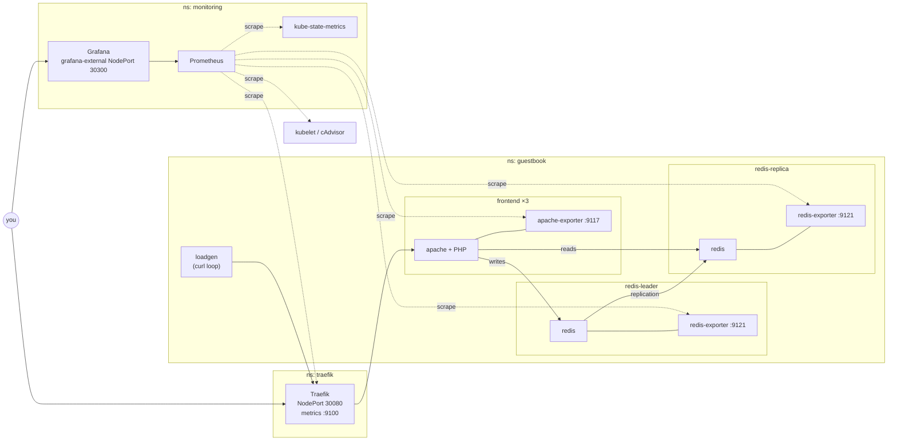
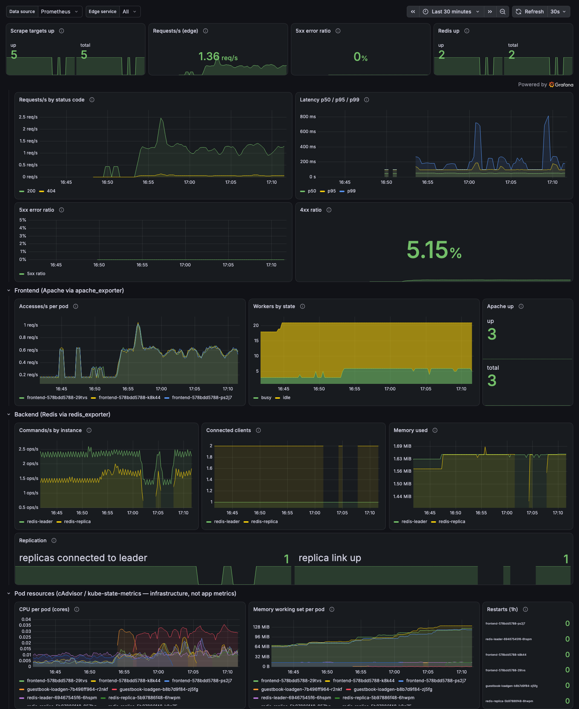

# Guestbook + Prometheus/Grafana monitoring (Pulumi, TypeScript)

The Pulumi [`kubernetes-ts-guestbook/simple`](https://github.com/pulumi/examples/tree/master/kubernetes-ts-guestbook/simple)
example on a local kind cluster, extended with kube-prometheus-stack, real application-level
metrics for every guestbook tier, a provisioned Grafana dashboard and a handful of alerts.
Everything is one `pulumi up`; `make verify` proves it end to end.



## What Guestbook exposes natively vs. what was added

| Source | What it measures | What it can't tell you |
|---|---|---|
| **Native application metrics** | **None.** The PHP frontend and Redis expose no Prometheus endpoint. | – |
| `apache_exporter` sidecar (frontend pods) | Apache `mod_status`: accesses/s, bytes, busy/idle workers, scoreboard, uptime, per pod | No HTTP status codes and no latency, so no error rate |
| `redis_exporter` sidecar (leader + replica) | Redis `INFO`: commands/s, connected clients, memory, keys, replication link and connected replicas | Anything about the HTTP side |
| Traefik edge (`traefik_service_*`) | Every request that reaches the guestbook: rate **by status code** and latency histogram | Per-pod breakdown (it sees the Service) |
| cAdvisor / kube-state-metrics | CPU, memory, restarts of the guestbook pods | **Infrastructure telemetry, not application metrics** – shown in its own clearly labelled dashboard row |

Traefik is there because `mod_status` has no status codes: error rate needs an edge proxy (or
instrumenting the app, which would mean rebuilding the upstream image).

## Prerequisites

- Docker (Docker Desktop / OrbStack / Colima) with **≥ 6 GB memory** – kube-prometheus-stack is heavy
- `kind`, `kubectl`, `helm`, `pulumi`, Node.js ≥ 20 + npm, `jq`, `curl`, `make`

  ```bash
  brew install kind kubectl helm pulumi/tap/pulumi node jq
  ```

No cloud account and no Pulumi Cloud login are needed: state lives in `./.pulumi-state`
(gitignored). The Makefile points `PULUMI_BACKEND_URL` there. If you'd rather use Pulumi Cloud,
`pulumi login` and drop that variable – nothing else changes.

## Deploy

```bash
export PULUMI_CONFIG_PASSPHRASE='pick-anything'   # encrypts the local state; keep it for later commands
make cluster up        # kind cluster + pulumi up
make verify            # acceptance test, PASS/FAIL table
```

A cold run takes roughly **10–15 minutes**, mostly image pulls for kube-prometheus-stack. After
that, `pulumi up` is incremental.

> The kube context is always explicit: every Pulumi resource goes through a `k8s.Provider` pinned
> to `kubeContext` (default `kind-guestbook-monitoring`) and every script passes
> `--context kind-guestbook-monitoring`. The ambient `current-context` is never used.

Run raw `pulumi` commands with the same backend the Makefile uses:

```bash
export PULUMI_BACKEND_URL="file://$PWD/.pulumi-state"
```

## Grafana access

```bash
pulumi stack output grafanaUrl                           # http://localhost:30300
pulumi stack output grafanaAdminUser                     # admin
pulumi stack output grafanaAdminPassword --show-secrets  # generated
pulumi stack output grafanaDashboardUrl                  # http://localhost:30300/d/guestbook-overview
```

The admin password is generated by `@pulumi/random`, stored in a Kubernetes Secret that the chart
consumes through `grafana.admin.existingSecret`, and exported as a Pulumi **secret** output.
The chart default (`admin` / `prom-operator`) is publicly known, and Grafana is exposed outside
the cluster here, so the default login is rejected (HTTP 401).

The app itself is at `pulumi stack output guestbookUrl` (http://localhost:30080).

## Verify Prometheus is scraping Guestbook

**a) UI** – `pulumi stack output prometheusPortForward` prints:

```bash
kubectl --context kind-guestbook-monitoring -n monitoring port-forward svc/kps-prometheus 9090:9090
```

Open http://localhost:9090/targets: the `serviceMonitor/guestbook/guestbook-frontend` (3
targets), `guestbook-redis-leader` and `guestbook-redis-replica` pools are `UP`, as is
`serviceMonitor/traefik/traefik`. No target anywhere is down.

**b) Queries to paste** into http://localhost:9090/query:

```promql
up{namespace="guestbook"}                                             # 5 series, all 1
count(apache_up{namespace="guestbook"} == 1)                          # 3
sum by (pod) (rate(apache_accesses_total{namespace="guestbook"}[1m]))
sum by (service) (rate(redis_commands_processed_total{namespace="guestbook"}[1m]))
redis_master_link_up{service="redis-replica"}                         # 1
sum by (code) (rate(traefik_service_requests_total{service=~".*frontend.*"}[1m]))
```

**c) `make verify`** checks pods, targets, exporter health, edge traffic, **every dashboard
panel query** (read from the dashboard JSON, so the test can't drift from the dashboard),
Grafana login and an end-to-end write → replicate → read through the edge.
Straight after a fresh deploy it retries failing checks every 15 s for up to 5 minutes
(`VERIFY_TIMEOUT`), since rates need a couple of scrapes before they exist.

### Why the Targets page is not empty (the #1 trap)

By default kube-prometheus-stack's Prometheus only selects ServiceMonitors/PrometheusRules
labelled `release: <helm release name>`. A ServiceMonitor without that label is silently
ignored and the Targets page stays empty. This repo uses **both** safeguards:

1. `prometheus.prometheusSpec.serviceMonitorSelectorNilUsesHelmValues: false` (and the
   `podMonitor`/`rule` equivalents), so Prometheus selects all of them; and
2. `release: kps` on every ServiceMonitor and PrometheusRule we create.

Either one alone is enough; together they survive someone reverting one of them.

## Dashboard tour – *Guestbook — Overview*

Defined in [`dashboards/guestbook-overview.json`](dashboards/guestbook-overview.json), shipped as a
`grafana_dashboard: "1"` ConfigMap that the Grafana sidecar loads (uid `guestbook-overview`).
Every panel's description names where its metric comes from.



- **Top strip** – scrape targets up / total, current req/s, 5xx ratio, Redis up.
- **Golden signals (edge – Traefik)** – requests/s by status code, latency p50/p95/p99, 5xx ratio
  over time, 4xx ratio (the load generator's deliberate 404s show up here).
- **Frontend (Apache via apache_exporter)** – accesses/s per pod, busy/idle workers, Apache up.
- **Backend (Redis via redis_exporter)** – commands/s per instance, connected clients, memory,
  replication (leader's connected replicas and replica's link status).
- **Pod resources (cAdvisor / kube-state-metrics)** – CPU, working-set memory, restarts. This is
  infrastructure telemetry, labelled as such, and not the application's own metrics.

The `datasource` and `edge_service` (regex `.*frontend.*`) variables avoid hard-coding a datasource
UID or Traefik's generated service name (`guestbook-frontend-80@kubernetes`).

## Alerts and runbooks

One `PrometheusRule` (`guestbook/guestbook`, defined in [`src/alerts.ts`](src/alerts.ts)):

| Alert | Expression | For | Severity |
|---|---|---|---|
| GuestbookScrapeTargetDown | `up{namespace="guestbook"} == 0` | 2m | warning |
| GuestbookHigh5xxRatio | edge 5xx ratio `> 0.05` | 5m | critical |
| GuestbookRedisDown | `redis_up{namespace="guestbook"} == 0` | 1m | critical |
| GuestbookRedisReplicationBroken | leader sees `< 1` replica **or** replica's `redis_master_link_up == 0` | 2m | warning |

Under normal load all four are `inactive`.

**Drill** (run during development):

```bash
kubectl --context kind-guestbook-monitoring -n guestbook scale deploy/redis-replica --replicas=0
# pending after ~20 s, firing after ~2m20s (2m `for:`)
kubectl --context kind-guestbook-monitoring -n guestbook scale deploy/redis-replica --replicas=1
# inactive again ~1 min later
```

Scaling the replica to zero removes its scrape target entirely, so `up == 0` and the replica's
own `redis_master_link_up` simply vanish rather than going to 0. That's why the replication
alert also checks the leader side (`redis_connected_slaves < 1`).

#### guestbookscrapetargetdown
An exporter or its pod is unhealthy. `kubectl -n guestbook get pods`; check the exporter
container logs (`-c apache-exporter` / `-c redis-exporter`) and readiness. On the frontend, check
that `curl localhost/server-status?auto` works inside the `frontend` container.

#### guestbookhigh5xxratio
Users are getting errors. Check the "Requests/s by status code" panel for when it started,
`kubectl -n guestbook logs deploy/frontend -c frontend`, then Redis health (the PHP app returns
errors when Redis is unreachable).

#### guestbookredisdown
Redis isn't answering its exporter. `kubectl -n guestbook describe pod -l app=redis-leader`
(or `redis-replica`), check OOMKilled/restarts, `redis-cli ping` in the container.

#### guestbookredisreplicationbroken
Reads are served by the replica and will be stale or empty. Check the replica is running, then
`kubectl -n guestbook exec deploy/redis-replica -c replica -- redis-cli info replication`
(`master_link_status`) and the replica logs for sync errors (see *Upstream issue found* below
for the classic one).

## Configuration reference

Non-secret defaults are declared in [`Pulumi.yaml`](Pulumi.yaml) (project config). Override them per
stack with `pulumi config set`:

| Key | Default | Meaning |
|---|---|---|
| `kubeContext` | `kind-guestbook-monitoring` | Kube context for the explicit provider. Never the ambient one. |
| `exposeAs` | `NodePort` | How Grafana (`grafana-external`) and Traefik are exposed: `NodePort` or `LoadBalancer`. |
| `nodeHost` | `localhost` | Host used in NodePort URLs in the outputs. |
| `skipLbAwait` | `false` | With `LoadBalancer`, don't wait for an address (useful on clusters without an LB implementation). |
| `frontendServiceType` | `ClusterIP` | Frontend Service type; traffic enters through Traefik. |
| `loadgen.enabled` | `true` | In-cluster traffic generator. `pulumi config set --path loadgen.enabled false` |

Image tags and chart versions are pinned in [`src/config.ts`](src/config.ts).

**On a cloud cluster:**

```bash
pulumi config set kubeContext <your-context>
pulumi config set exposeAs LoadBalancer
pulumi up
pulumi stack output grafanaUrl     # http://<lb address>
pulumi stack output guestbookUrl
```

Pulumi waits for the LoadBalancer addresses and puts them in the outputs. If an address isn't
ready yet, the output says `pending — run: pulumi refresh`.

## Design decisions and trade-offs

| Decision | Choice | Why |
|---|---|---|
| Base | `pulumi/examples` `kubernetes-ts-guestbook/simple` | Straight port of the canonical YAML; easy to diff against (commit 1 is the verbatim import). |
| Cluster | kind, single node, `extraPortMappings` 30080/30300 | Reproducible on any laptop, no cloud account. |
| Prometheus + Grafana | `kube-prometheus-stack` via `k8s.helm.v3.Release` | Helm owns the CRD lifecycle and the install is atomic; `helm list` is a familiar view. Trade-off: Pulumi sees the Release, not each rendered object. `helm.v4.Chart` would render every object into Pulumi state (finer diffs), but then Pulumi has to sequence CRDs and CRs itself. |
| Scrape discovery | `ServiceMonitor` CRs | Explicit, reviewable and namespaced next to the app. `prometheus.io/scrape` annotations are the operator-less alternative; doing both would double-scrape. |
| Frontend metrics | `apache_exporter` **sidecar** | Zero changes to the app image. `/server-status` stays `Require local` (the image already enables it), so it isn't exposed through the Service. A separate exporter Deployment couldn't reach `localhost` and would need the status page opened up. |
| Backend metrics | `redis_exporter` sidecars | Real Redis metrics per instance; sidecar shares the pod lifecycle and network namespace. |
| Request/error rate | Traefik edge with Prometheus metrics | `mod_status` has no status codes. ingress-nginx is retired (Kubernetes SIG Network ended maintenance in March 2026), so Traefik. |
| Grafana exposure | Pulumi-owned `grafana-external` Service | Pulumi owns exposure and can output the address as a typed value; NodePort by default because `LoadBalancer` stays `<pending>` on kind. |
| Grafana credentials | `RandomPassword` → Secret → `existingSecret`, secret output | No well-known default credentials on an exposed service. |
| Dashboard | JSON file → ConfigMap → Grafana sidecar | Dashboard as code; stays an editable/exportable file. |
| Traffic | In-cluster `loadgen` through Traefik, on by default | Dashboards have data the moment you open Grafana; ~5% deliberate 404s exercise the error panels. |
| Namespaces | `guestbook`, `monitoring`, `traefik` | Upstream deploys to `default`; a small, documented divergence. |
| State | Local file backend, stack `dev` | No Pulumi Cloud account required. |
| Config | Project-level config in `Pulumi.yaml`; `Pulumi.dev.yaml` gitignored | The stack file carries an encryption salt bound to *your* passphrase, so committing it would break `make up` for anyone else. |

Divergences from upstream: namespaces; `isMinikube` replaced by `frontendServiceType`; stable
resource names (`deploy/frontend`, …); pinned images; named Service ports plus a `metrics` port; the
replica image swap below.

### Upstream issue found: Redis replication was silently broken

Upstream runs an **unpinned** `redis` leader (today Redis 8.10.3) with the 2020
`pulumi/guestbook-redis-replica` image (Redis 6.0.5). The replica can't load the leader's
snapshot and loops forever:

```
# Can't handle RDB format version 15
# Failed trying to load the MASTER synchronization DB from disk
```

`master_link_status:down`, and since the PHP frontend **reads from the replica**, every
`get` returned `{"data": ""}`: writes succeeded, but messages never appeared. Fix: both leader and
replica run the same pinned `redis:8.10.3`, the replica with `--replicaof redis-leader 6379`.
(Pinning the leader back to 6.0 also works, but 6.0 is end-of-life.) `make verify` and the
`GuestbookRedisReplicationBroken` alert now guard this.

## Known limitations

- No persistent storage for Prometheus (2d retention), Grafana or Redis: a pod restart loses history / guestbook data.
- kind-specific: NodePorts 30080/30300 are mapped to the host in `cluster/kind-config.yaml`; they must be free.
- Single Redis leader, no Sentinel/failover. The replica only serves reads.
- `pulumi/guestbook-php-redis` is published for `amd64` only. On Apple Silicon it runs under
  emulation; it works, but expect higher frontend latency/CPU than on amd64.
- Loadgen traffic is synthetic and uniform: good for proving the pipeline, not for capacity numbers.
- The Ingress has no published address under NodePort (`pulumi.com/skipAwait` is set so Pulumi
  doesn't wait for one). With `exposeAs=LoadBalancer` Traefik publishes the LB address on it.
- `kubeEtcd`, `kubeControllerManager`, `kubeScheduler`, `kubeProxy` scraping is disabled: kind binds
  them to 127.0.0.1, so they'd be permanently-down targets with firing alerts.

## Teardown

```bash
make down    # pulumi destroy (cluster stays)
make clean   # kind delete cluster --name guestbook-monitoring
```

## Versions

| Component | Version |
|---|---|
| kind / node image | v0.32.0 / `kindest/node:v1.36.1@sha256:3489c767…` |
| Pulumi CLI | 3.273.0 |
| `@pulumi/pulumi` / `@pulumi/kubernetes` / `@pulumi/random` | 3.273.0 / 4.34.2 / 4.21.4 |
| TypeScript / `@types/node` | 5.9.3 / 22.13.14 |
| kube-prometheus-stack chart | 92.14.1 (operator v0.94.2) |
| Prometheus / Alertmanager | v3.15.1 / v0.34.1 |
| Grafana | 13.2.4 |
| kube-state-metrics / node-exporter | v2.20.0 / v1.12.1 |
| Traefik chart / Traefik | 42.1.3 / v3.7.16 |
| Redis (leader + replica) | `redis:8.10.3` |
| Guestbook frontend | `pulumi/guestbook-php-redis@sha256:f21cbff3…` (upstream publishes only `latest`) |
| apache_exporter | `lusotycoon/apache-exporter:v1.1.1` |
| redis_exporter | `oliver006/redis_exporter:v1.96.0` |
| loadgen | `curlimages/curl:8.23.0` |

## Credit

Based on [pulumi/examples `kubernetes-ts-guestbook/simple`](https://github.com/pulumi/examples/tree/master/kubernetes-ts-guestbook/simple)
(Apache-2.0, © Pulumi Corporation; see [NOTICE](NOTICE)). The first commit is the verbatim
import, so everything added on top is:

```bash
git diff $(git rev-list --max-parents=0 HEAD)..HEAD
```
